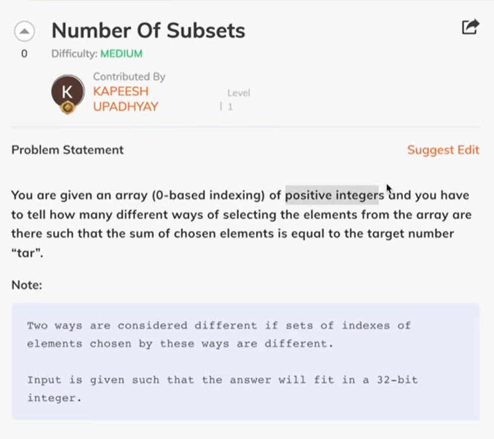

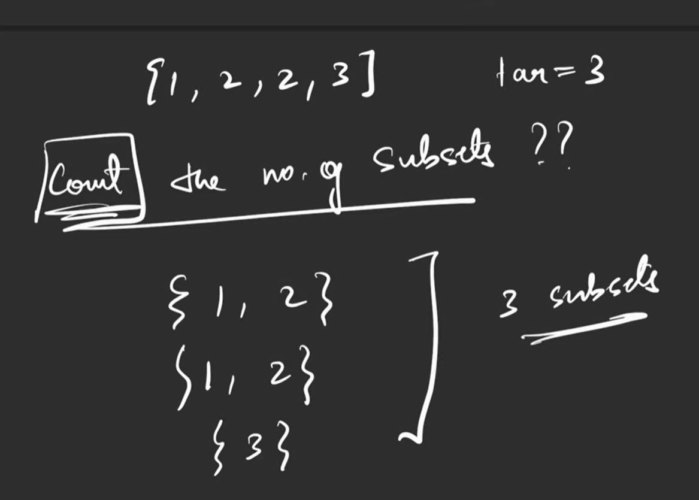

in general

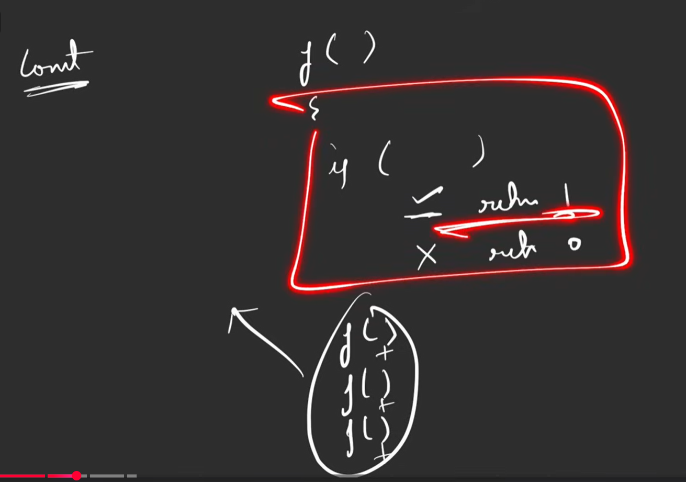

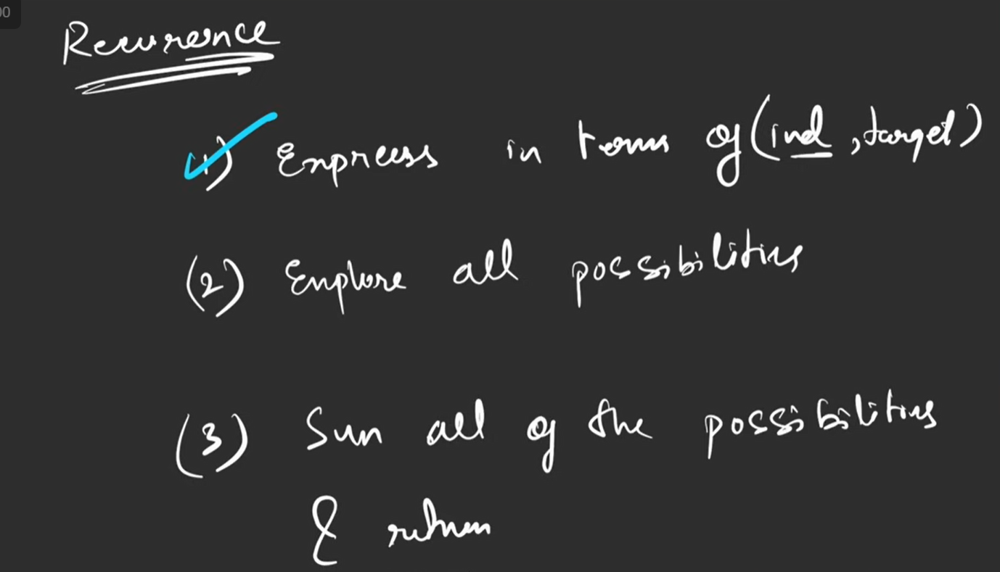

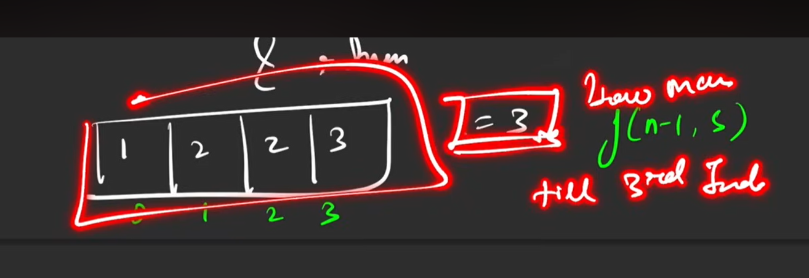
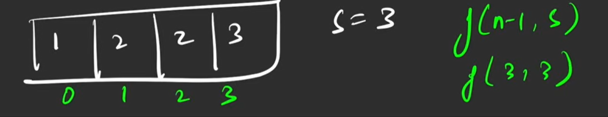
this mean till 3rd index how many will give sum 3

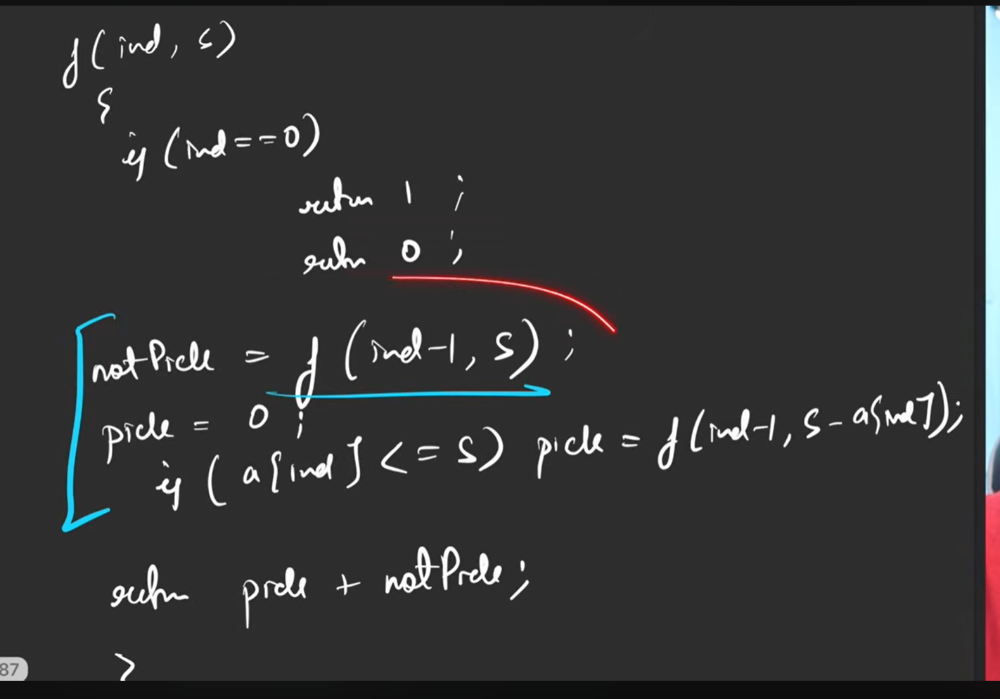

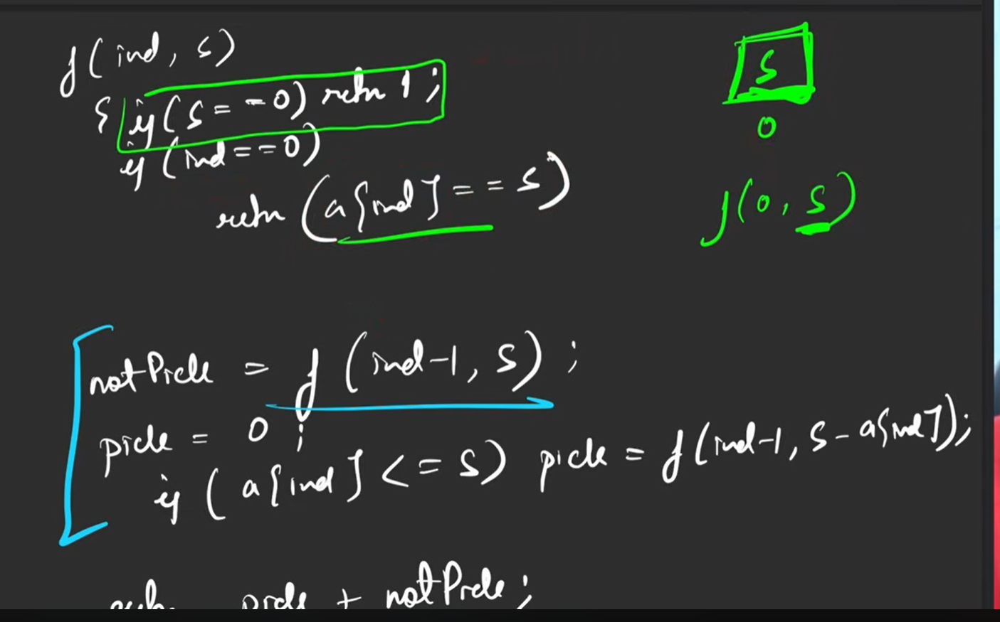

ARR[0] IS WAHT WE NEED IN SUM  TAHTS CASE
AND 
if sum 0 then not picking is also in case

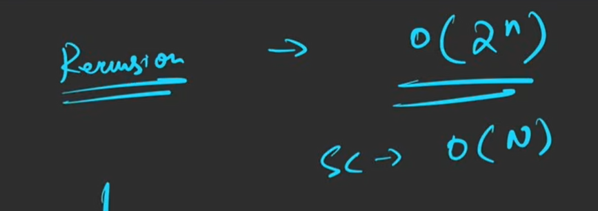

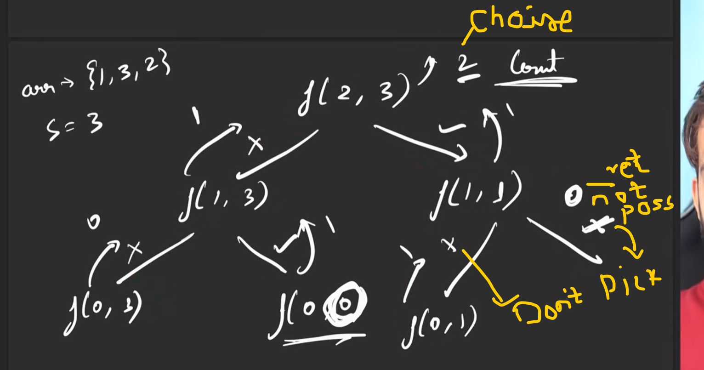

memorization

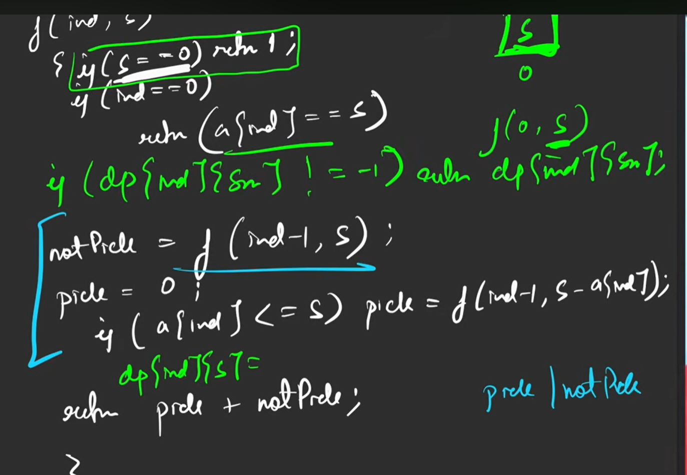

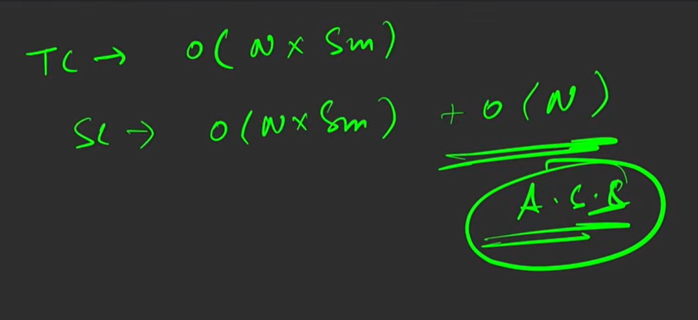

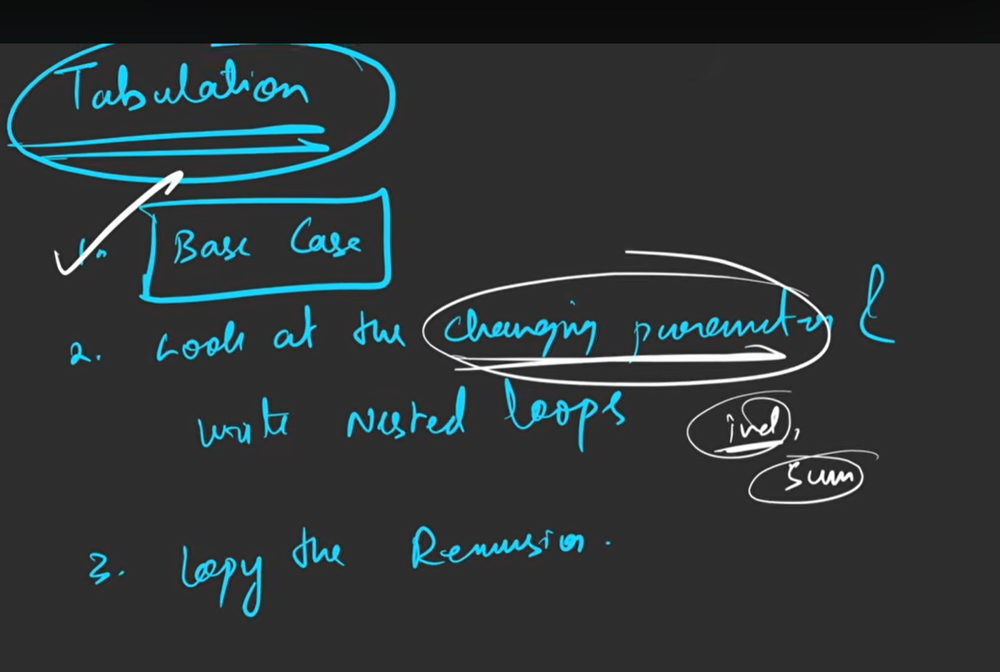

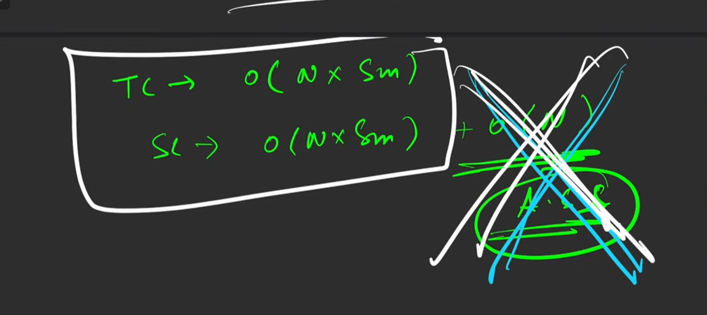

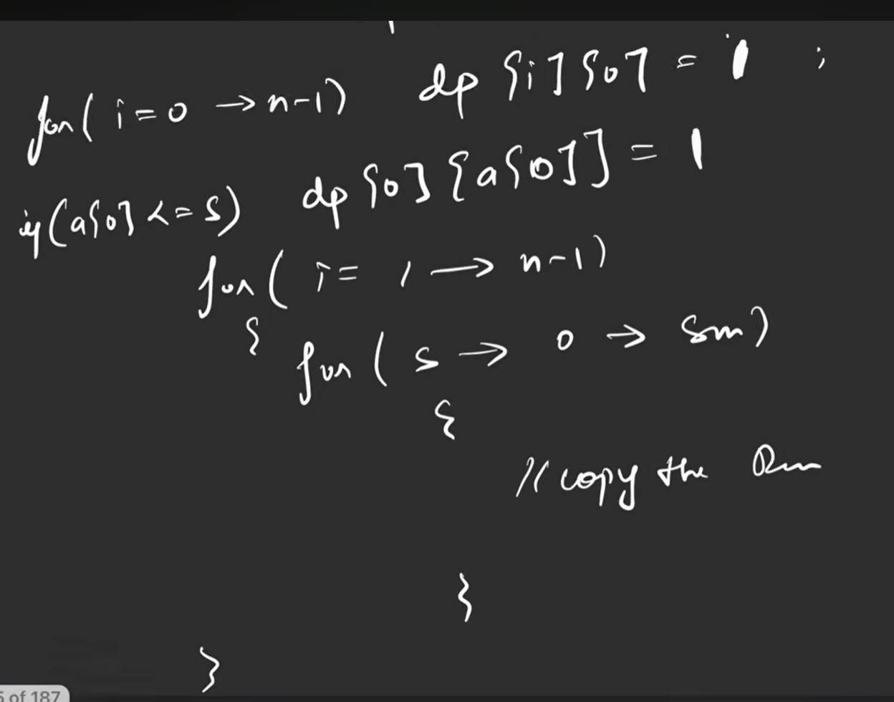

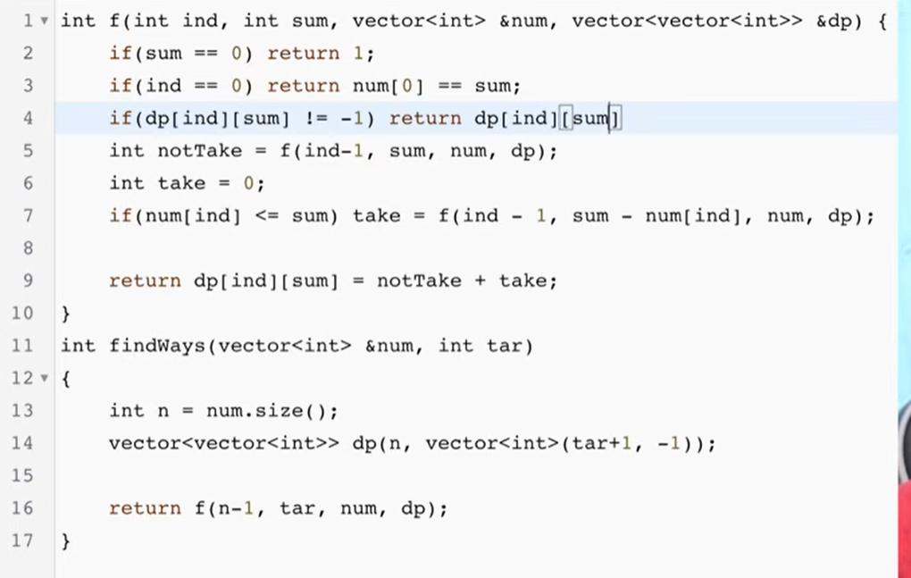

opt

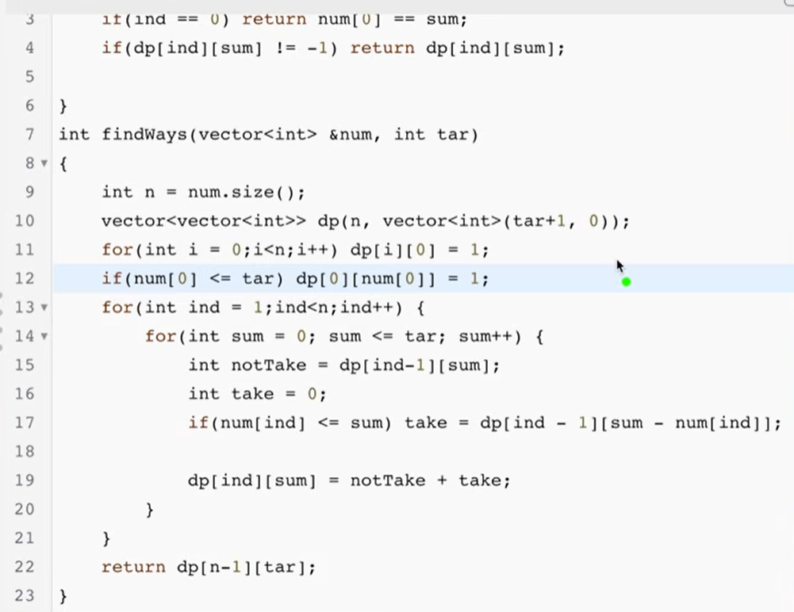

since ind-1 so more opt possible

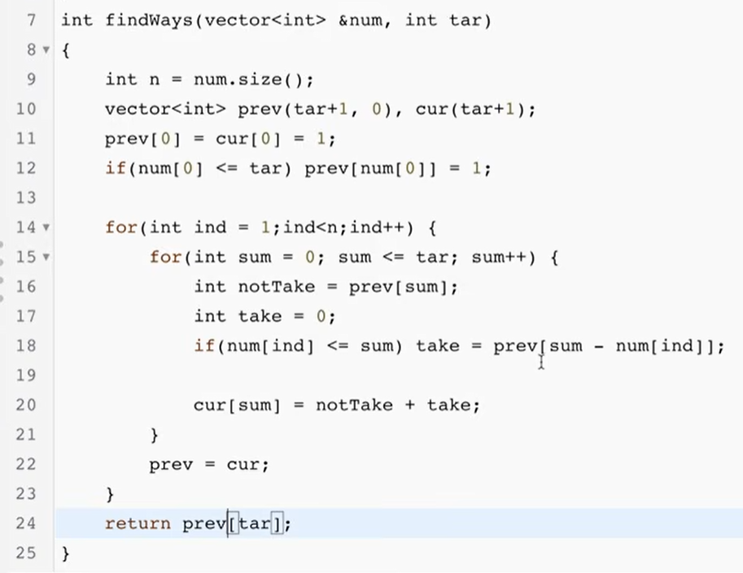